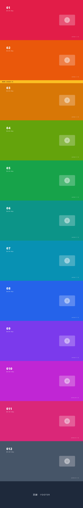

# 滚动长截图网页插件

[](https://github.com/Cdkgfp/webpage-long-screenshot-plugin/actions/workflows/ci.yml)
[](LICENSE)
[](extension/manifest.json)

一个极简的浏览器长截图插件：**只有「截屏」一个按钮**。点击后自动滚动网页、逐屏截取、拼接成一张完整长图，并保存到下载目录。

> An ultra-minimal Chrome / Edge extension. One button: it scrolls the page, stitches every viewport into a single long screenshot, and saves it to your Downloads folder.


## 特性

- **一个按钮**：没有设置、没有选项，点「截屏」即可。
- **自动滚动拼接**：从页面顶部滚到底部，逐屏截取后无缝拼接成整页长图。
- **固定顶栏 / 吸顶条去重**：截图期间自动隐藏 `position: fixed` 元素；吸顶元素只在正常排版位置出现，长图不会每隔一屏重复一次导航栏。
- **清理「首屏浮层」**：截图前会先自动预热滚动一次，触发站点自身的滚动逻辑，避免「首次滚动后才消失」的评论框、浮动工具条等被截进长图中部。
- **无法滚动截图的页面自动兜底**：新标签页、浏览器内部页面等无法注入脚本时，不再直接报「不支持截图」，而是尝试把**当前可视区域**截成一张普通截图保存；只有浏览器完全禁止截取该页面时才提示原因。
- **隐藏滚动条**：截图时临时隐藏滚动条，右侧不会出现重复的滚动条。
- **懒加载友好**：滚动到底会二次确认页高，滚动加载变长的页面也能完整截取。
- **高清输出**：按屏幕像素比（DPR）截图，Retina 屏也清晰；超长页面会自动等比缩放到画布上限内。
- **进度可见**：按钮内显示进度文字与进度条，工具栏图标角标显示百分比。
- **不污染页面**：截完自动恢复滚动位置、滚动条与被隐藏的元素。
- **隐私友好**：仅 `activeTab`（点击插件时才授权当前标签页）、`downloads`、`scripting`、`offscreen` 权限，不联网上传任何数据。

## 下载安装

### 方式一：下载安装包（推荐）

前往 [Releases](https://github.com/Cdkgfp/webpage-long-screenshot-plugin/releases/latest) 下载最新的 `long-screenshot-v*.zip`，解压后得到 `extension` 目录，按下面的「加载已解压的扩展」步骤安装。

### 方式二：从源码加载

插件本体在 `extension/` 目录，Chrome / Edge（Chromium 内核浏览器）均可加载。

#### Edge

1. 地址栏打开 `edge://extensions/`
2. 打开左下角「开发人员模式」
3. 点击「加载解压缩的扩展」，选择本项目的 **`extension`** 文件夹
4. 把「一键滚动长截图」固定到工具栏

#### Chrome

1. 地址栏打开 `chrome://extensions/`
2. 打开右上角「开发者模式」
3. 点击「加载已解压的扩展程序」，选择本项目的 **`extension`** 文件夹

## 使用

1. 打开要截图的网页。
2. 点击工具栏上的插件图标，弹窗里只有一个按钮：**「截屏」**。
3. 点击它，页面会自动从顶部滚动到底部；弹窗会显示进度，工具栏图标角标显示百分比。
4. 完成后自动保存到**下载目录**，页面右上角会弹出一条成功提示：
   - 正常网页：`长截图_example.com_20261027-184908.png`（完整长图）；
   - 无法滚动截图的页面：`屏幕截图_xxx_20261027-191234.png`（当前可视区域截图）。
5. 再截一张只需再点同一个按钮。

## 注意事项

- 浏览器内部页面（`chrome://`、`edge://`、新标签页、扩展商店等）无法注入脚本，插件会退化为「截取当前可视区域」；但**是否允许截取最终由浏览器决定**，部分页面（如某些浏览器的新标签页）会被浏览器本身禁止截取，此时才会提示无法截取。
- 截图过程中**不要切换标签页、不要手动滚动页面**，否则会中断并提示「已切换标签页」。
- 页面极长时：最多截取 60 屏、60000 CSS 像素高度；超出后会在页面提示「页面过长，已截取前 N 屏」。输出高度上限约 30000 像素，超过会等比缩小。
- 内容以 `<iframe>` 内嵌的页面不会展开，只截取主页面可见区域。
- 如需截取本地 `file://` 页面，需要在扩展详情页打开「允许访问文件网址」。
- 截图时固定定位的悬浮组件（客服气泡、Cookie 弹窗、悬浮导航等）会被隐藏，这是为了让长图内容完整、不重复；站点在首次滚动后会自己消失的首屏浮层也不会残留。
- 页面自身的滚动事件、懒加载图片会在滚动过程中触发，属正常现象；截完会自动滚回原位置。

## 目录结构

```
extension/              插件本体（加载这个目录）
  manifest.json         Manifest V3 配置
  background.js         调度：滚动、逐屏截图、拼接、保存、进度、兜底截图
  page-agent.js         页面侧代理：预热滚动、测量、滚动、隐藏固定/吸顶元素、恢复现场
  offscreen.html/.js    离屏文档：用 Canvas 把各屏拼接成长图（或直接输出单屏截图）
  popup.html/.css/.js   弹窗：只有一个「截屏」按钮
  icons/                16 / 32 / 48 / 128 图标
test/                   自动化验证
  site/                 测试页面（固定区块、滚动变长、一屏、CSP 沙箱、首屏浮层、兜底截图）
  e2e.mjs               用本机 Edge 加载插件做真实截图并保存 PNG（两轮：正常流程 + 兜底流程）
  verify.py             对生成的长图做尺寸 / 像素级校验
  out/                  验证产物（弹窗截图、示例长图、校验数据）
scripts/validate.mjs    仓库静态校验（Manifest 引用、图标尺寸、README 图片链接）
tools/make_icons.py     图标生成脚本
.github/workflows/      CI（静态校验 + 手动触发 E2E）与 Release 工作流
```

## 实现原理

1. 点击按钮后，后台向当前标签页注入 `page-agent.js`，用 `chrome.scripting.insertCSS` 注入截图专用样式（隐藏滚动条、固定元素、关闭平滑滚动）。使用 `insertCSS` 可以绕过页面自身的 CSP 限制。
2. 页面代理先做一次「预热滚动」（向下滚一小段再回到顶部），触发站点滚动监听，让只在首屏出现的浮层被站点自己隐藏；同时把吸顶元素的静态位置记录下来。
3. 逐屏 `scrollTo`，每步等待渲染，并用 `chrome.tabs.captureVisibleTab` 截取当前视口；每屏都会重新扫描 `fixed` 元素、并根据吸顶元素是否偏离静态位置决定是否隐藏。
4. 每张截图立即发到离屏文档（`chrome.offscreen`），按实际滚动位置画到同一张 Canvas 上；首尾像素按 1:1 对齐，避免拼接缝和纵向拉伸。
5. 滚动中动态重新测量页高，处理图片懒加载 / 滚动加载导致的页面变长，直到真正触底。
6. 拼接完成后 `canvas.toBlob` 生成 PNG，用 `chrome.downloads` 保存，最后恢复页面原状并显示成功提示。
7. 若页面无法注入脚本，则跳过滚动，直接用 `captureVisibleTab` 截取当前视口，经离屏画布输出普通截图并保存。

## 开发与验证

项目自带一套真实浏览器端到端测试（需要本机安装 Microsoft Edge）：

```bash
# 用测试专用 profile 启动 Edge，加载插件，打开测试页并触发真实截图
# 生成的图片与元数据在 test/out/
node test/e2e.mjs

# 对生成的长图做尺寸与关键像素校验（需要 Python + Pillow）
python test/verify.py
```

CI（[`.github/workflows/ci.yml`](.github/workflows/ci.yml)）在每次 push / PR 时执行静态检查；在 Actions 页面手动触发 `CI` 时，会额外在 Windows runner 上跑一遍真实 Edge 截图测试。

测试覆盖：

| 用例 | 内容 | 期望 |
| --- | --- | --- |
| index | 7600px 长页 + 固定顶栏 + 吸顶条 + 懒加载图片 | 输出 7600px 高，无固定顶栏、无重复、无拼接缝 |
| grow | 初始 1800px，滚动时动态追加到 6000px | 输出 6000px 高，10 个区块顺序正确 |
| short | 一屏页面 | 输出正好一屏高度 |
| sandbox | 带 CSP `sandbox` 的页面 | 仍能正常截图（注入样式不受页面 CSP 影响） |
| transient | 首屏有「首次滚动后消失」的评论框 + 固定底栏 | 长图中不残留这两个浮层 |
| fallback | 页面代理故意注入失败（模拟无法注入的页面） | 退化为可视区域截图，输出正好一屏高度 |

最近一次验证结果（Edge 153 / headless，全部通过）：

```
index      1254x7600  10 帧  320871 字节
grow       1254x6000   9 帧  212606 字节
short      1254x807    1 帧   30069 字节
sandbox    1254x807    1 帧   34102 字节
transient  1254x4407   6 帧  148560 字节
fallback   1254x807    1 帧   34417 字节  （fallback=true）
全部像素校验通过 OK
```

示例长图：

## 开源协议

[MIT](LICENSE) © 2026 Cdkgfp

欢迎提交 Issue / PR。如果这个插件帮到了你，点个 Star 就是最好的支持 ⭐

## 版本

v1.1.0 · 变更记录见 [CHANGELOG.md](CHANGELOG.md)
